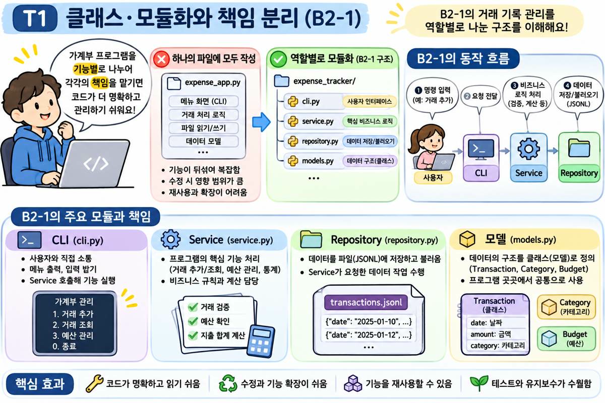
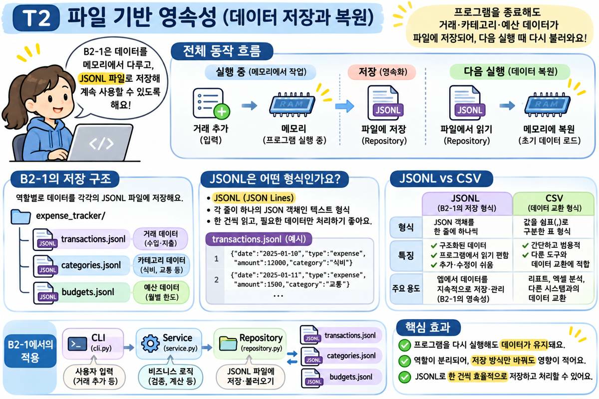
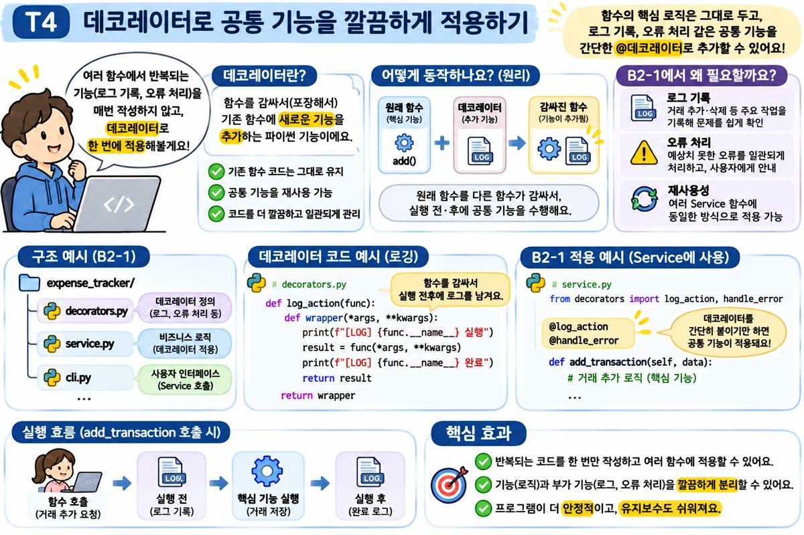
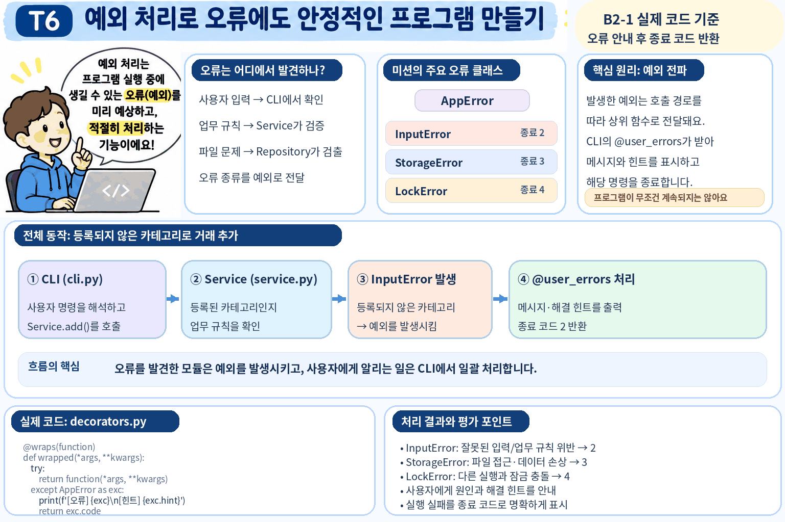
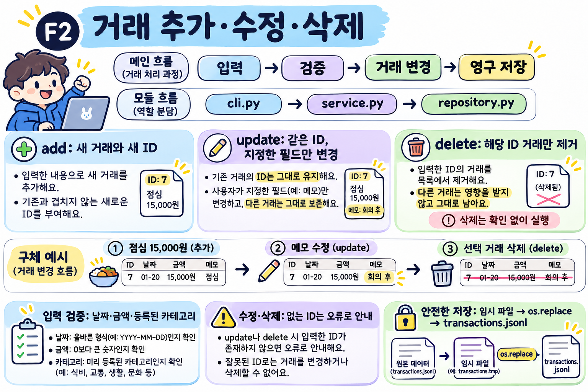
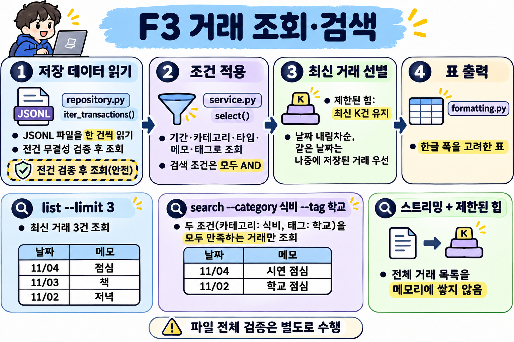
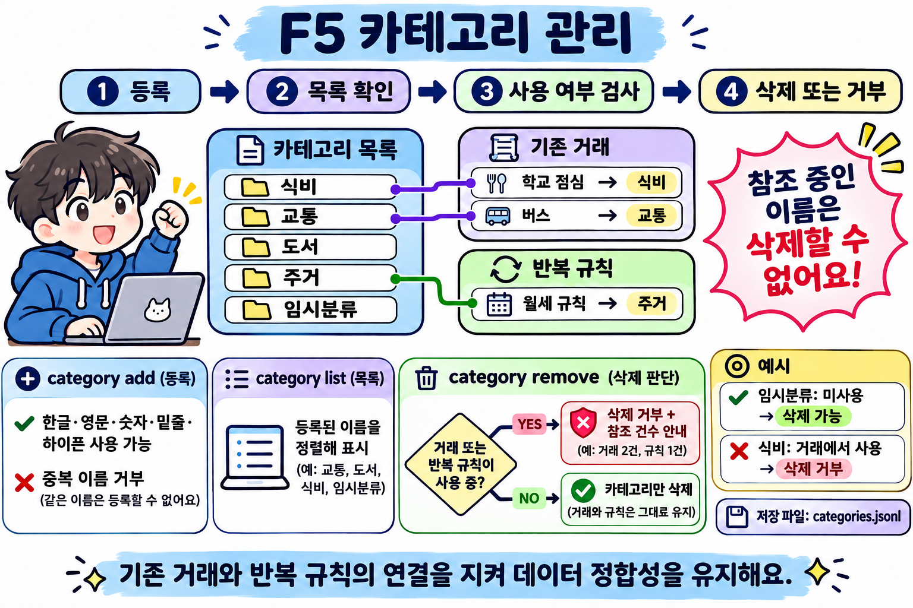
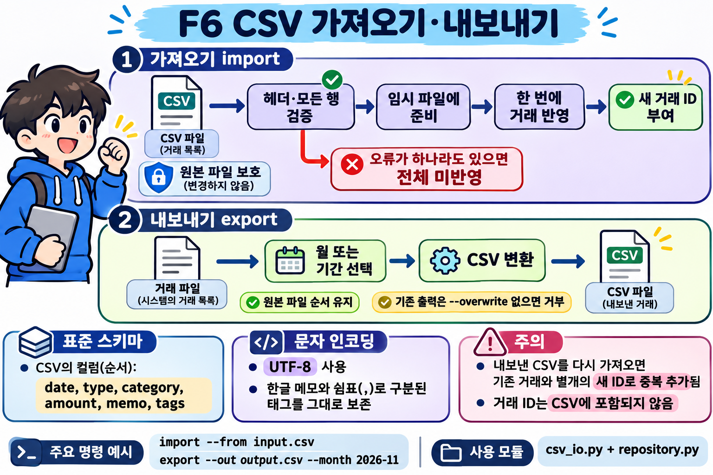
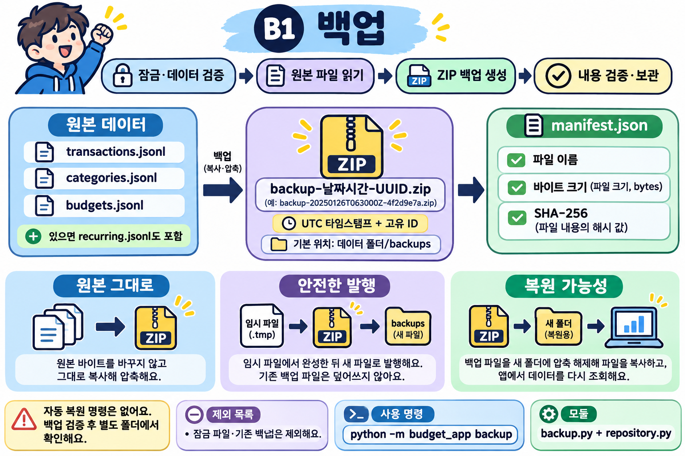
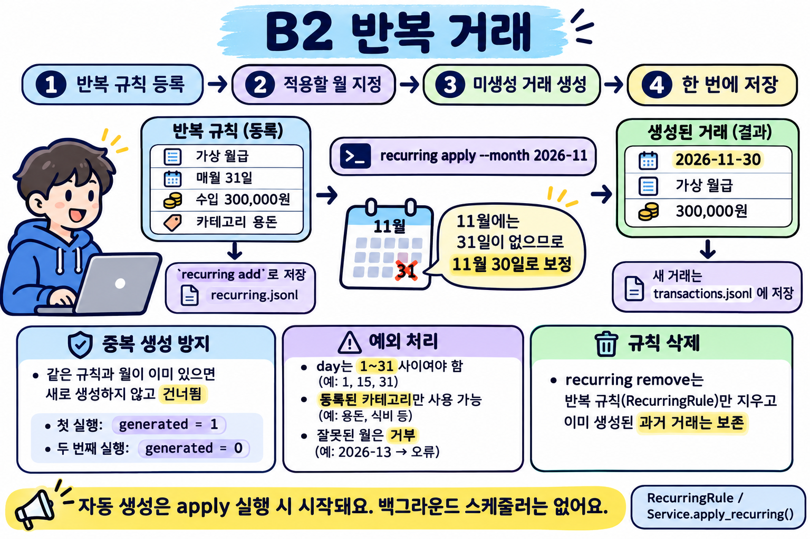

# 프로그램 학습 그림 모음

`docs/diagrams/`의 파일 중 이름에 `illustrated`가 포함된 그림을 T → F → B 순서와 번호순으로 나열한다.

## T1

[원본 파일 보기](diagrams/T1-illustrated.svg)

## T2

[원본 파일 보기](diagrams/T2-illustrated.svg)

## T3

[원본 파일 보기](diagrams/T3-illustrated.svg)

## T4

[원본 파일 보기](diagrams/T4-illustrated.svg)

## T5

[원본 파일 보기](diagrams/T5-illustrated.svg)

## T6

[원본 파일 보기](diagrams/T6-illustrated.png)

## F1

[원본 파일 보기](diagrams/F1-illustrated.png)

## F2

[원본 파일 보기](diagrams/F2-illustrated.png)

## F3

[원본 파일 보기](diagrams/F3-illustrated.png)

## F4

[원본 파일 보기](diagrams/F4-illustrated.png)

## F5

[원본 파일 보기](diagrams/F5-illustrated.png)

## F6

[원본 파일 보기](diagrams/F6-illustrated.png)

## F7

[원본 파일 보기](diagrams/F7-illustrated.png)

## F8

[원본 파일 보기](diagrams/F8-illustrated.png)

## B1

[원본 파일 보기](diagrams/B1-illustrated.png)

## B2

[원본 파일 보기](diagrams/B2-illustrated.png)

## B3

[원본 파일 보기](diagrams/B3-illustrated.png)

